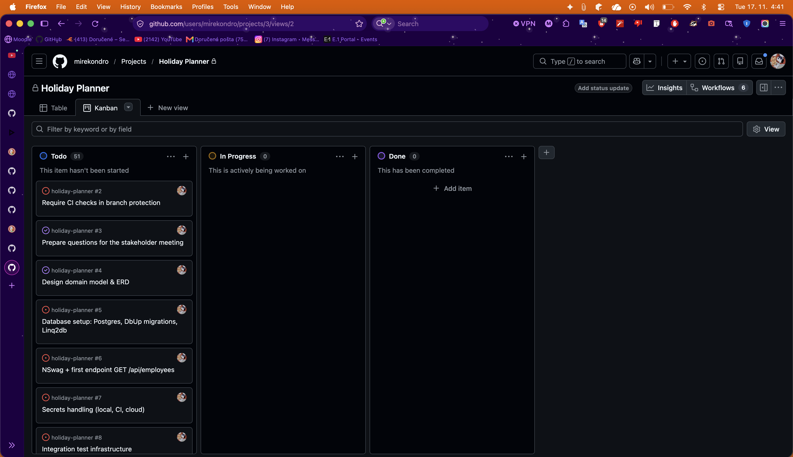

# Holiday Planner – Business Esbjerg

## Deployed links

## Current state

## Authorization policies

Users log in with email + password (`POST /api/auth/login`) and get a JWT (valid 60 min) that the client sends as `Authorization: Bearer <token>`. Every endpoint requires a valid token unless it is explicitly marked `[AllowAnonymous]` (secure by default – fallback policy in `server/BE.Api/Auth/Policies.cs`).

### Roles

| Role | Who | Accounts |
|---|---|---|
| **Employee** | Every person in the organisation (`x@businessesbjerg.com`) | one per employee, linked to the employee record |
| **Accountant** | Approves / declines requests | exactly one, separate login (not linked to an employee) |
| **SystemOwner** | Administers the system | exactly one, separate login (not linked to an employee) |

The accountant is also an employee and logs in with their *employee* account to apply for their own holiday.

### Who can access what

| Action | Anonymous | Employee | Accountant | SystemOwner | Policy |
|---|:-:|:-:|:-:|:-:|---|
| Log in | ✅ | ✅ | ✅ | ✅ | `[AllowAnonymous]` + rate limit (5/min per IP) |
| See own account (`GET /api/auth/me`) | ❌ | ✅ | ✅ | ✅ | authenticated |
| See employees and everyone's planned holiday | ❌ | ✅ | ✅ | ✅ | authenticated |
| Apply for holiday / cancellation / transfer | ❌ | ✅ (own only) | ❌ | ❌ | `Employee` |
| Approve / decline requests | ❌ | ❌ | ✅ | ❌ | `Accountant` |
| Edit work schedules | ❌ | ❌ | ✅ | ✅ | `ManageSchedules` |
| Create and list users (`/api/users`) | ❌ | ❌ | ❌ | ✅ | `SystemOwner` |
| Edit global rules, public holidays, presets | ❌ | ❌ | ❌ | ✅ | `SystemOwner` |

Rows without an endpoint yet describe the policy the endpoint will use when it is built.

### How passwords and secrets are handled

- Passwords are hashed with ASP.NET Core Identity's `PasswordHasher` (PBKDF2-HMAC-SHA512, 100 000 iterations, random salt per password). Plain passwords are never stored or logged.
- Password policy: 12–128 characters (length instead of forced character classes, NIST SP 800-63B).
- Login gives the same error for an unknown email and a wrong password, and takes the same time, so it does not reveal which accounts exist.
- Database rules back up the code: unique email, only `@businessesbjerg.com`, at most one Accountant and one SystemOwner (`0003_app_user.sql`).
- No secrets in git. The JWT signing key and the first system owner come from user-secrets locally and environment variables in the cloud:

```bash
cd server/BE.Api
dotnet user-secrets set "Jwt:Key" "<random string, at least 32 characters>"
dotnet user-secrets set "Bootstrap:SystemOwnerEmail" "owner@businessesbjerg.com"
dotnet user-secrets set "Bootstrap:SystemOwnerPassword" "<at least 12 characters>"
```

In the cloud the same keys are environment variables: `Jwt__Key`, `Bootstrap__SystemOwnerEmail`, `Bootstrap__SystemOwnerPassword`. The system owner is only created when no system owner exists yet.

## Testing strategy

## GitHub Project progression
### Start (17 Nov 2026)



## Sustainability (Lighthouse)

## Further work

## AI disclosure

| Area | How AI was used                                                                                                                          |
|---|------------------------------------------------------------------------------------------------------------------------------------------|
| Brainstorming | Claude was used to plan the work split between group members.                                                              |
| Generated files | `scripts/setup-github.sh`, `scripts/create-issues.sh` and `scripts/update-issues.sh` were generated by Claude. `.github/workflows/ci.yml`. Authentication/authorization (`server/BE.Api/Auth/*`, `AuthController`, `UsersController`, `Contracts/AuthContracts.cs`, `BE.Domain/Users/*`, `0003_app_user.sql` and their tests) was generated by Claude. |
| Generated text | The GitHub issues, labels and milestones (created by `scripts/create-issues.sh`, updated by `scripts/update-issues.sh` after the 16 Nov clarifications) were generated by Claude and reviewed by us. |
| Feedback |                                                                                                                                          |
